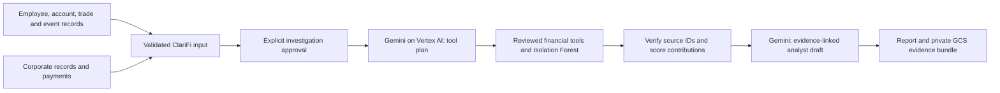

# ClariFi financial investigation agent

ClariFi adds two BFSI investigation capabilities to this workbench: potential
insider-trading indicators and shell-company/payment-network indicators. An analyst
supplies company records, approves an investigation, and receives explainable
scores, source references, model provenance and a draft investigation narrative.
Findings are leads for review, not determinations that a person or company committed
financial crime. No trading, account blocking, regulatory filing or personnel action
is automated.

The Streamlit sidebar includes **ClariFi Agent**, with separate
insider-trading and shell-company screens and a **Run Investigation** button.
The original screens and upload → proposals → approval → generated code → Docker
→ results flow remain available. Employee productivity and migration agents are
outside this change.

The ClariFi landing page follows the existing ClariFi system typography, light
surfaces and restrained blue accents. **ClariFi Capabilities** introduces company
onboarding reviews and employee trading investigations with the required evidence
and expected outputs. Intake supports structured JSON, CSV tables and `.xlsx`
workbooks. Download the capability-specific Excel template in the page, replace
all synthetic rows, and keep its sheet names and headers. Dates must be ISO 8601
text with timezone offsets, IDs must be text, and formulas are rejected. Company
due diligence uses supplied evidence; it does not search external registries.

Choose **Combined investigation** to upload all seven tables and run both reviewed
tools in one approved investigation. A larger downloadable workbook and comparison
guide are in `outputs/clarifi-demo-01a14a33/`; the combined screen also offers them
when present. Its 2,493 operational rows are simulated and include historical-name
references to the Wahi/Coinbase and Good Star/1MDB public cases. The guide separates
those case facts from invented trading and company connections. This constructed
fixture is not held-out accuracy evidence. Reproduce the JSON and baseline with
`python scripts/generate_clarifi_sample.py`. The workbook builder uses the bundled
Artifact Tool runtime. The Excel reader accepts text-entry apostrophes on ISO
timestamps and worksheets without declared dimensions, while retaining row,
column, decompression, formula and timezone validation.

## How the agent fits



`workbench.agents.AGENTS` registers ClariFi. Both `Service.run_agent(...)` and the
Cloud Run API use that registry. The implementation runs a separate LangGraph
with planning, tool invocation, evidence verification and report drafting stages.
Gemini or local Gemma chooses the order of the applicable tools and explains the plan; the host
requires every applicable tool exactly once. Model output cannot introduce another
tool, arbitrary Python, SQL, external searches or commands. Scores and disposition
rules are computed by reviewed code; Gemini drafts follow-up questions and
explanations using the top 25 findings. Full computed findings remain in the report.
Draft references are checked against their associated finding, but reference checks
do not prove the draft's semantic correctness. An analyst must review the text.

This is a constrained investigation agent, not an autonomous financial decision
maker. It runs synchronously in one request and does not provide durable mid-run
resume. Failed planning, model generation, evidence verification or storage returns
an error rather than a completed report or a substituted offline result.

The original workflow executes newly generated programs through Docker on a local
host. ClariFi executes only reviewed application functions, so its Cloud Run service
requires neither a Docker daemon nor privileged execution. The original local model
settings and cloud-endpoint restrictions are unchanged.

## Two investigation capabilities

### Potential insider-trading indicators

Supply employees, account owners, trades and optionally declared related-account
relationships and public market events. An employee's `access_issuers` is a supplied
record of issuer-specific access; it does not establish actual access to particular
inside information. Market events must be supplied explicitly; no live event feed,
public company search or external identity database is queried.

Direct employee-ID matches, matching pseudonymous identity keys and explicitly
declared related accounts provide stronger attribution. Full-name and initial
matches create identity-review leads. The agent does not infer family relationships
from surnames or shared initials. Conflicting identity records prevent escalation.
Names are normalized for case, spacing and punctuation, not transliteration or
nickname equivalence. Common initials can produce multiple candidates.

| Signal | Points | Evidence required |
| --- | ---: | --- |
| Employee ID, identity key or declared related account | 40 | Employee and account records; declaration reference for related accounts |
| Full-name match without corroboration | 20 | Employee and account names |
| Initials only | 5 | Employee and account names |
| Trade within 14 days before a supplied public event | 25 | Same issuer; strictly earlier trade timestamp |
| Issuer-specific employee access supplied | 20 | Employee access record |
| Preclearance explicitly recorded as false | 10 | Trade record; missing data adds no points |
| Notional anomaly at or above the 95th percentile | 5 | Isolation Forest on the supplied issuer/currency batch |

Identity signals are alternatives, not cumulative. Scores are capped at 100.
`analyst_review` additionally requires corroborated identity, issuer access and
pre-event timing. A score alone cannot bypass these conditions. `identity_review`
and `insufficient_evidence` expose uncertainty. Preclearance or a low score does
not establish that trading is lawful. No realized profit, price movement, beneficial
control or actual possession of inside information is inferred.

### Shell-company and payment-network indicators

Supply corporate entities and payments. The tool checks chronological same-currency
payment cycles of three or four distinct entities within 30 days and shared bank
accounts, addresses, routing numbers and asserted owners. This adapts the existing
ClariFi financial graph approach. The insider-trading tool is a new capability;
it was not present in the inspected ClariFi invoice backend.

| Signal | Points |
| --- | ---: |
| Baseline | 5 |
| Chronological payment cycle | 45 |
| Shared bank account | 20 |
| Shared normalized address | 10 |
| Asserted owner participates in a cycle, with a source reference | 10 |
| Shared bank routing number or shared owner alone | 0 |
| All detected cycles have supplied documented treasury context | −65 |

Scores are clamped to 0–100; scores of at least 65 create an analyst-review lead.
A routing number identifies a bank rather than a shared customer account. Shared
details alone do not prove common control. Treasury mitigation requires every
entity and payment in every relevant cycle to carry the documented treasury
context, and the report still asks for corroboration.

The original ClariFi PDF/Document AI extraction, invoice-to-payment reconciliation,
rapid onward-payment signal, BigQuery queries and policy retrieval adapters are
not ported in this first agent integration. The current agent must not describe a
payment cycle as proven circular invoicing. BigQuery, Document AI, Vertex AI Search,
Pub/Sub and Cloud SQL are optional future adapters, not services claimed by this
implementation. Its actual cloud integrations are Vertex AI Gemini and GCS.

## Input contracts and CSV ingestion

Use `examples/clarifi/financial_case.json` as a complete synthetic input. JSON table
names and required fields are:

| Table | Required columns | Optional columns |
| --- | --- | --- |
| employees | employee_id, name | identity_key, access_issuers |
| accounts | account_id, owner_name | employee_id, identity_key |
| relationships | relationship_id, employee_id, account_id, relationship, source_reference | — |
| trades | trade_id, account_id, issuer_id, occurred_at, side, quantity, price, currency | precleared |
| events | event_id, issuer_id, public_at | description |
| entities | entity_id, name | registered_address, bank_account, bank_routing, owner_entity_id, ownership_source, legitimate_group, business_purpose |
| payments | transaction_id, sender_id, receiver_id, amount, currency, occurred_at | purpose, invoice_id |

Relationships are `spouse`, `dependent` or `declared_related_party`. Sides are `buy`
or `sell`. Timestamps must include UTC or an offset. Amounts must be finite and
positive; currencies use three uppercase letters. All IDs are unique within their
table, and foreign keys must resolve. Identifiers should be opaque pseudonyms;
model context contains record identifiers, not names, bank details, addresses or
relationship-reference text. Pseudonymous IDs can still be sensitive.

The API limits the complete body to 5 MiB. Per-input limits are 300 employees,
1,000 accounts, 1,000 relationships, 5,000 trades, 300 events, 200 entities and
5,000 payments. Graph traversal and finding counts also have explicit limits.
Oversized investigations must be scoped before running; this prototype is not a
whole-bank streaming analytics engine.

```sh
python -m pip install -r requirements-clarifi.txt
python scripts/clarifi_import.py --case-id company-review \
  --employees employees.csv --accounts accounts.csv --trades trades.csv \
  --relationships declared_relationships.csv --events public_events.csv \
  --entities companies.csv --payments payments.csv --output investigation.json
```

CSV headers follow the table above. `access_issuers` uses `ACME|OTHER`; precleared
uses `true`, `false` or an empty cell for unknown. Omit the unrelated tables when
running only one capability. Empty optional cells use schema defaults. The importer
refuses existing output files. Keep real inputs, account/employee data and reports
outside Git and the container build context.

## Run locally

For an AI Studio key, save `GEMINI_API_KEY` in the repository's ignored `.env`
file and optionally set `CLARIFI_API_MODEL=gemini-3.5-flash-lite`. Select **Gemini API ·
AI Studio** in the financial UI, check the connection, review the input and approve
the investigation. No key is entered through the UI or included in reports. The
adapter uses Google's Interactions REST API through HTTPX with structured JSON
responses, `store=False`, credentials in headers and one attempt per request.
There are no automatic retries of quota failures. Model lookup still uses
`google-genai>=2,<3`. API model availability and quota
are checked against the configured project; model lookup alone does not establish
generation readiness. The configured model is explicit; no automatic fallback is
used. Local Gemma and Vertex AI remain separate choices.

Local Gemini API verification accepted the configured credential for model lookup,
completed a minimal text request and a structured tool plan, but the complete
financial investigation did not pass: draft and planning requests encountered
client-side timeouts. A subsequent direct HTTP check returned 429 with Google's
explicit free-tier limit of 20 requests per day for the configured model. SDK
Interactions retries were observed sleeping after 429 responses; the generation
path now uses one direct request and reports quota and transport failures
separately. Wait for the project quota reset or upgrade its tier before retrying.
Gemini 3.5 Flash-Lite subsequently completed the small combined case with real
planning and evidence-linked drafts (10 findings, both tools, `ai_used=true`).
It also completed the 2,493-row simulated workbook case with 990 findings and
validated AI planning and analyst text. The larger draft initially received HTTP
400 with tightly bounded cloud array cardinality; removing those cloud-only
claim-count bounds resolved that run. Pydantic limits and the agent's exact
finding coverage, score and citation checks remain enforced locally. Narratives
still cover the top 25 findings; all 990 findings remain in the full report.
Gemini 3.8 full investigation execution remains blocked by its quota. Local Gemma's previously verified investigations
remain available. No Gemini cloud result is substituted with offline output.

### Model choices and hackathon deployment

The **Google AI model** picker offers Gemini 3.5 and 3.1 Flash-Lite, Gemini 3.8,
3.7 and 3.6 Flash, earlier 2.5 text models, experimental hosted Gemma 4 models,
and a custom model ID. The default is the verified `gemini-3.5-flash-lite`.
Changing the model invalidates the previous approval and results. The system never
silently switches models after a quota or validation failure. Each completed
investigation normally uses two requests; model lookup checks do not verify
generation readiness. Quotas are project-specific and are not hardcoded in the UI.

Hosted Gemma 4 26B model lookup passed, but the structured planning test timed out;
Gemma 4 31B has not been verified end to end. These candidates are labeled
experimental. Local Gemma 3 via Ollama remains a separately verified path. Earlier
2.5 models may be unavailable to newer projects even if the dashboard lists them.

The dashboard's Live API rows apply to persistent sessions, not to the structured
Interactions calls used here. Their unlimited cells do not establish unlimited
request capacity, tokens or free use for this agent. Live audio, TTS, image,
embedding and music models are deliberately excluded from the investigation picker.
See [Google's supported Interactions models](https://ai.google.dev/gemini-api/docs/interactions-overview)
and [rate-limit documentation](https://ai.google.dev/gemini-api/docs/rate-limits).

Gemini/Gemma reasoning covers the model-family portion of the supplied hackathon
requirement. The prototype still needs actual Cloud Run or Firebase deployment;
running on localhost is not a deployed submission. The Cloud Run API deployment
script accepts either `CLARIFI_MODE=vertex` (existing default, service-account ADC)
or `CLARIFI_MODE=gemini` (Gemini or hosted Gemma API, Secret Manager key reference).
For API mode, set `CLARIFI_API_KEY_SECRET=YOUR_EXISTING_SECRET:VERSION` and an
explicit `CLARIFI_API_MODEL` such as `gemini-3.5-flash-lite`. The runtime service
account needs access to that secret version and the private evidence bucket.
This API-only script deploys a private investigation service. For the complete
application, use [the full GCP deployment](GCP-DEPLOYMENT.md): Streamlit and the
Docker-dependent workflows run on Compute Engine, and ClariFi calls Cloud Run
using the VM service identity. Without that configuration, the UI remains local.
Model availability and quota for Vertex AI must be verified separately. Cloud Run
deployment and GCP IAM have not been executed or verified in this workspace.

The opt-in synthetic Gemini check is:

```sh
python scripts/clarifi_gemini_verify.py --approve-model-run
```

For the model-backed UI, install Ollama and use a separate terminal for its server.
The following example keeps model weights in the ignored workspace directory:

```sh
python -m pip install -r requirements-clarifi.txt
OLLAMA_MODELS="$PWD/workspaces/local-models" ollama serve
# In another terminal:
ollama pull gemma3:1b
CLARIFI_LOCAL_MODEL=gemma3:1b python -m streamlit run app.py --server.port 8510
```

Open `http://127.0.0.1:8510/?sector=finance`, or choose **ClariFi Agent**
from the existing sidebar. Select one capability, review the synthetic input or
upload separate CSV tables/a JSON bundle, check the local model, approve the input,
then click **Run Investigation**. Results show the review queue, scores, directed
payment connections, source rows, analyst draft, execution evidence and JSON export.
Payment charts separate currencies and support cycles; the graph shows at most
100 supplied payments while all validated rows are investigated.

The local model uses Ollama's structured generation with a planning schema scoped
to the available tools. No automatic model fallback is allowed. `gemma3:1b` is a
small starting model for this walkthrough, not evidence of production reasoning
quality. A larger downloaded model can be selected by its exact ID in the UI.
The original CSV workflow retains its own model settings and Docker requirements.

Completed UI reports and validated inputs are saved under `workspaces/clarifi/`,
outside the original `uc_*` namespace. The UI can reopen these reports after a
restart. Changing the active input/model hides stale results and requires fresh
approval. These local files are single-user prototype storage, not shared cloud
case storage. The private Cloud Run API remains the GCP deployment entrypoint.

Without an approval flag, the CLI validates the input and prints an approval
checkpoint; it calls no model or financial tools:

```sh
python scripts/clarifi_agent.py examples/clarifi/financial_case.json --mode rules
python scripts/clarifi_agent.py examples/clarifi/financial_case.json \
  --mode rules --approve-investigation --output /tmp/clarifi-report.json
```

`rules` is an explicitly labeled offline development mode. It uses no Gemini and
does not satisfy the hackathon AI requirement. For actual Gemini execution:

```sh
gcloud auth application-default login
export GOOGLE_CLOUD_PROJECT=your-project
export GOOGLE_CLOUD_LOCATION=global
export CLARIFI_GEMINI_MODEL=your-available-gemini-model-id
python scripts/clarifi_agent.py examples/clarifi/financial_case.json \
  --mode vertex --approve-investigation
```

Select a model actually available to your project/location; there is no assumed
model availability or automatic fallback. There are two bounded structured model
calls per successful run. Gemini-generated scores are never used. If
`CLARIFI_EVIDENCE_BUCKET` is set, the CLI and API persist a bundle containing the
validated source records and report in that private bucket before returning success.

The same native agent is callable from the existing application service:

```python
from workbench.service import Service
report = Service().run_agent("clarifi", validated_input_dict, approved=True, mode="vertex")
```

That method returns a report and leaves original workspace state untouched. Use
the API or CLI when durable GCS evidence export is needed. The financial UI keeps
multi-table intake and approval separate from the original single-CSV form.

## API and Cloud Run

```sh
CLARIFI_MODE=rules python -m uvicorn workbench.agents.clarifi.api:app \
  --host 127.0.0.1 --port 8080
```

`GET /agents` discovers the registered capabilities. `GET /input-schema` returns
the complete JSON schema. `POST /investigations` accepts
`{"approved": true, "data": {"case_id": "...", "employees": [], "...": []}}`.
Submit actual tables from the example; the ellipsis is illustrative. `GET /healthz`
is liveness only and does not establish Vertex or bucket readiness. Local API auth
is delegated to the loopback boundary; deployed access is enforced by Cloud Run IAM.

The supplied `Dockerfile.clarifi` serves this API on `$PORT` as a non-root user.
Its Dockerfile-specific ignore file includes only application code and dependency
files, preserving the original sandbox build context. Build from the repository
root. No Docker socket is mounted and no child containers are started.

Before deployment, configure a billing-enabled project, enable Cloud Run, Cloud
Build, Artifact Registry, Vertex AI and Cloud Storage APIs, create an Artifact
Registry Docker repository, a dedicated runtime service account and a private
uniform-access evidence bucket. Give the runtime identity `roles/aiplatform.user`
on the project and `roles/storage.objectCreator` on that bucket. It does not need
project-wide storage administration. The build identity needs artifact-upload
permissions; the deployer needs permission to deploy and act as the runtime service
account. Grant `roles/run.invoker` to the intended callers. Set appropriate bucket
residency, retention and access for uploaded financial and employee data.

Review and explicitly run these commands to create billable cloud resources:

```sh
export PROJECT_ID=your-project
export REGION=us-central1
export TAG=your-reviewed-build-tag
export CLARIFI_GEMINI_MODEL=your-available-gemini-model-id
export CLARIFI_EVIDENCE_BUCKET=your-private-evidence-bucket
export CLARIFI_SERVICE_ACCOUNT=clarifi-runtime@your-project.iam.gserviceaccount.com
bash deploy/clarifi/deploy.sh
```

The script builds the named Dockerfile using Cloud Build and deploys an
authenticated Cloud Run API with a dedicated runtime identity, two CPUs, 2 GiB
memory, concurrency two, a 300-second timeout and at most two instances. It sets
Vertex mode and requires durable evidence storage. It does not create IAM bindings,
enable APIs, create buckets or make the service public. ADC supplies credentials;
no service-account key is copied into the image.

For an authenticated request, put the API wrapper in a file, then call the URL
printed by deployment with a Cloud Run identity token:

```sh
curl -H "Authorization: Bearer $(gcloud auth print-identity-token)" \
  -H 'Content-Type: application/json' --data-binary @request.json \
  https://YOUR-SERVICE-URL/investigations
```

Completed evidence uses
`gs://BUCKET/investigations/CASE_ID/INVESTIGATION_ID.json`; create-only generation
preconditions prevent overwriting a prior run. The prototype exposes no case-list
or evidence-download endpoint. Retries create new investigation IDs and may incur
new model calls. Add user-level authorization, idempotency, grouped case storage
and queued execution before a multi-tenant production rollout. Cloud Run IAM
alone does not provide case-level permissions.

Official platform references:
[Cloud Run runtime contract](https://docs.cloud.google.com/run/docs/container-contract),
[container deployment](https://docs.cloud.google.com/run/docs/deploying),
[Vertex AI SDK](https://docs.cloud.google.com/vertex-ai/generative-ai/docs/sdks/overview),
[Google Gen AI structured responses](https://googleapis.github.io/python-genai/).

## Scores, ML and the 80–90% target

The Isolation Forest model describes unusual log notionals in the supplied batch,
separately for issuer/currency in trading and currency in payments. It needs at
least 20 rows and three distinct amounts, uses a fixed seed, and produces an anomaly
percentile. It is unsupervised and retrospective. It has no labeled outcome accuracy,
is not a forward prediction and is not a calibrated fraud probability. Payment
anomaly percentiles are supplementary and do not alter shell-company scores.

Treat 80–90% as a validation target, not an achieved result. Obtain independent,
analyst-adjudicated outcomes, split by company/person and time to avoid leakage,
tune on a development set, freeze rules and thresholds, and evaluate once on the
held-out set. Include benign treasury cycles, unrelated people with common initials,
missing/conflicting identity records, lawful related-party activity and mixed
currencies. Report results separately for both capabilities and evaluate identity
matching separately from trade-risk disposition. Related findings from one person
are not independent examples.

`workbench.agents.clarifi.evaluation.evaluate(report, labels)` calculates confusion
counts, precision, recall, F1, prevalence and accuracy with a descriptive Wilson
interval. It requires a separate boolean label for every finding and uses the
frozen `analyst_review` disposition. Its interval assumes independent examples;
use grouped evaluation for real corporate/person datasets. The model never receives
these labels. High accuracy on a mostly negative dataset can still miss most risky
cases. Synthetic regression tests establish intended behavior, not financial-crime
detection accuracy.

## Verification and remaining boundaries

The local verification record is [clarifi-verification.json](../clarifi-verification.json).
The two model-backed UI flows completed through Streamlit AppTest using the actual
local `gemma3:1b` model: six insider-trading findings (two analyst-review leads,
three identity-review leads; highest score 95/100) and four shell-company findings
(two analyst-review leads; highest score 80/100). The initial shell-only trial
selected an unavailable tool and was rejected; scoping the model's decoding schema
to the available tools resolved that observed failure. The in-app browser could
not connect to localhost, so visual browser verification remains outstanding even
though the server health endpoint returned HTTP 200 and the UI flows completed.
The samples do not meet the ML fit minimum; a separate repeatability test exercises
a 40-trade ML batch. These results establish local execution, not real-world accuracy.

Run `python -m pytest tests -q` after installing the optional requirements. Original
Docker/live-model tests retain their opt-in flags. New tests cover identity ambiguity,
declared family accounts, timing and issuer scope, payment cycles, treasury mitigation,
ML repeatability, evidence reconciliation, approval, structured model contracts,
API failures and evaluation counts. The offline synthetic example is reproducible.
Mocked Vertex responses verify the adapter contract, not Vertex model availability or
quality. Live Vertex, GCS permissions, the Linux container build and an authenticated
Cloud Run deployment require project access and separate verification. No deployment
or measured 80–90% accuracy is implied by source or unit tests.

## Local migration → sandboxed ClariFi

The optional **Prepare with Migration** path reuses `MigrationService` and the
workbench Docker sandbox. The existing direct-input ClariFi and Migration Studio
flows remain available.

1. Open **New workspace**, upload financial files, and include **use ClariFi agent**
   in the instruction. The request opens financial preparation rather than the
   general code-generation workflow. Alternatively, choose **ClariFi Agent →
   Prepare with Migration** directly.
2. Choose insider trading, shell-company networks, or the combined scope. Upload
   CSV files, an Excel workbook, or JSON tables, at most 5 MiB combined. Assign
   each file/sheet/table to an evidence table. Required tables must occur once;
   combine split exports for the same table before uploading. Empty optional
   JSON arrays/worksheets are omitted. PDF extraction is not implemented here.
3. Request a mapping proposal for each table. The existing local mapping model
   proposes field correspondences. Review and edit the mappings, resolve
   ambiguity, then explicitly approve each plan. No model-generated transformation
   executes on the host. Financial proposals use a keyed response contract that
   requires every target field and restricts source columns to the actual table.
   The existing structured client permits at most three schema attempts. A source
   identifier proposed for multiple identifier roles is marked ambiguous until
   the reviewer resolves it; model confidence is not evidence of correctness.
4. **Convert and validate in sandbox** executes each approved migration using
   the existing Docker lifecycle. It preserves record counts and keeps financial
   source text, identifiers, and timezone offsets until an approved conversion
   changes them. The assembled bundle must pass the ClariFi schema, unique-ID,
   positive-value and cross-table-reference checks. The CSV handoff is also
   compared with the independently validated materialized database table. Incomplete output blocks
   investigation; absent relationships and evidence are not invented.
5. Review the converted records and download the prepared JSON if needed. Choose
   the ClariFi reasoning model and explicitly approve the investigation. Financial
   rules and ML tools execute in a fresh Docker container using the same network,
   capability, memory, CPU, timeout and cleanup controls as migration. Model
   planning/explanation runs in the application process, outside the container;
   the sandbox receives neither credentials nor network access. Direct-input
   investigations retain their existing in-process execution behavior.

This path requires a **rebuilt sandbox image**, even when the old migration image
is already installed:

```bash
docker build -t agentic-workbench-sandbox:latest -f sandbox/Dockerfile .
python -m streamlit run app.py --server.port 8510
```

The image now includes Pydantic plus only the reviewed ClariFi schemas/tools.
Docker failures stop execution; there is no host-execution fallback. The prepared
path uses a local orchestrator with Docker access, even if `CLARIFI_API_URL` is set
for the separate direct-input cloud mode. Its model picker therefore offers local
Gemma, Gemini API, Vertex Gemini and explicit rules-only mode, rather than the
remote ClariFi API. Mapping proposals still use the configured workbench local
model. Rules-only mode does not invoke an AI model for investigation.

Preparations are stored under
`WORKSPACE_ROOT/clarifi-pipelines/<workspace>/`. Each has isolated migration child
workspaces, source file hashes, approved mappings, converted-output hashes,
financial validation and an investigation report. Changing prepared data, mapping
approval or a converted output invalidates the handoff. Reopen a preparation from
**Resume a financial preparation**. To change an approved mapping or source file,
create a new preparation; approval remains immutable for that run.

Checks:

```bash
python -m pytest tests/test_clarifi_preparation.py tests/test_clarifi_preparation_ui.py -m 'not docker'
RUN_DOCKER_TESTS=1 python -m pytest tests/test_clarifi_preparation.py -m docker
```

Unit/UI tests use explicit model and execution fakes. Only the Docker-marked tests
exercise real container isolation and migration-to-investigation execution; model
quality and production throughput require separate measurement. No GCP resource
or deployment change is required for this local integration.

### Gemma 4 deployment option

The official Ollama tag for the requested 12B instruction-tuned QAT model is
`gemma4:12b-it-qat` (not `gemma4-12b-iat`). Install it with
`ollama pull gemma4:12b-it-qat` and select that exact local model ID. The Ollama
adapter explicitly sends `think=false` for this Gemma 4 family to reserve the
bounded time/output budget for the validated JSON answer; older models retain
their original request settings. Schema, evidence and score validation still
apply, and there is no automatic model fallback.

The GCP installer accepts a separate `CLARIFI_LOCAL_MODEL` setting while
`OLLAMA_MODEL` controls Migration Studio and the general workbench. It downloads
both models when these settings differ. Benchmark a full investigation on the
actual hardware before changing its default; a model download or simple JSON
check alone does not establish useful latency or investigation quality.

Sources: [Ollama Gemma 4 12B QAT](https://ollama.com/library/gemma4:12b-it-qat),
[Ollama thinking controls](https://docs.ollama.com/capabilities/thinking).

### Local model timeouts and availability checks

ClariFi no longer hardcodes a 180-second model request deadline. Set
`CLARIFI_LLM_TIMEOUT_SECONDS=600` in the ignored local `.env` or server environment.
This takes precedence over `LLM_TIMEOUT_SECONDS`; if neither is configured, ClariFi
uses 600 seconds. The deadline applies to each model request, not the complete
investigation, and does not guarantee that an arbitrary workload will finish.
The GCP bootstrap explicitly configures ClariFi to 600 seconds. Restart cloud UI
services after server environment changes; rerun the local Streamlit app after
source changes.

“Model available” confirms the model is installed and Ollama responds. It does
not execute a full planning/draft check. The UI displays the effective model
request timeout after the availability check. A timeout returns no completed
investigation; no model or rules fallback runs automatically.

For local Gemma, analyst drafts now use batches of at most five findings. Each
batch uses required finding-ID keys and evidence IDs constrained to that finding.
The agent still verifies exact coverage and citations before reporting success.
The full computed findings stay intact; at most 25 receive model explanations.
A 25-finding local draft therefore needs five draft requests plus planning,
before any bounded schema-repair requests. Gemini's existing request flow is
unchanged. This limits per-request work; it is not a guarantee of lower total
latency or semantic accuracy.

### Installed models and visible investigation stages

The local model picker lists the tags actually installed on the application
server through Ollama, cached for 30 seconds. Use **Refresh installed models**
after downloading a model, or choose manual entry for an exact ID. On the GCP
VM, `gemma3:4b` and `gemma4:12b-it-qat` are installed. The latter is marked
experimental on CPU, remains opt-in, and requires fresh investigation approval.
A model installed on the VM is not automatically installed on a local laptop.

The direct financial investigation UI now streams planning, tool execution,
evidence verification, and draft-batch events. LangGraph custom events are
consumed on the UI caller thread; request-scoped listeners reset on completion
or failure. Progress is descriptive, not a fabricated completion percentage or
latency promise. Computed outputs, evidence checks and approval rules remain
unchanged. The remote Gemini HTTP handoff does not expose internal stage events.
