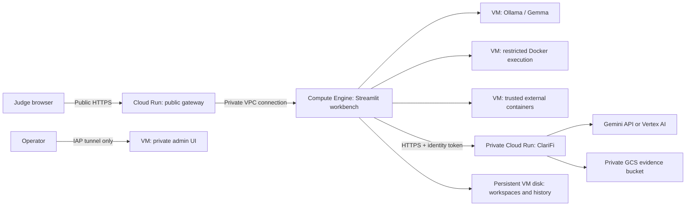

# Full workbench on Google Cloud

Judges open the public **HTTPS Cloud Run URL** printed by the installer. No Google
login, custom domain or SSH tunnel is required for the demo. A Cloud Run gateway
proxies HTTP and WebSockets over Direct VPC egress to the workbench VM. Only this
tagged gateway can reach the VM's internal application proxy.

This deployment keeps Home, Migration Studio, Data Workbench, workspace history,
results and external Docker applications together on a Compute Engine VM. The
ready-to-use ClariFi screen offers an explicit choice between Gemma on the VM
and Gemini in the private ClariFi Cloud Run service. Gemma is the default when
`CLARIFI_ENABLE_LOCAL=true`; it keeps reasoning and saved reports on the VM.
The Gemini choice uses the VM service identity and persists completed input/report
bundles in private Cloud Storage. A remote failure never silently selects Gemma.

The newer **Prepare with Migration** path uses the VM's shared Docker sandbox
for both conversion and financial tools. Its local orchestrator runs model calls
outside Docker and saves the migration audit trail/report on the VM disk. This
path does not delegate investigation to the private ClariFi Cloud Run API.

This is a prepared **public hackathon prototype deployment**, not a verified cloud
installation or a production multi-tenant service. VM/cloud integration and model latency
must pass the checks below in the actual project. The supplied hackathon wording
requires Cloud Run or Firebase; here the financial investigation engine genuinely
runs on Cloud Run, while Docker-dependent workflows run on Compute Engine. The
public HTTPS entrypoint also runs on Cloud Run; Streamlit itself runs on the VM.

### Requirement review (18 October 2026)

- The [published requirements](https://aibuildercup.com/themes.html) require
  Google AI models (Gemini/Gemma) **or** an agentic platform, and deployment via
  Cloud Run or Firebase. A VM-only link or a local port-forward is insufficient
  under that wording.
- At [08:09](https://www.youtube.com/watch?v=_75UeGNj1GY&t=489s) in the expert
  session, Cloud Run/Firebase deployment is stated as mandatory. At
  [24:42–25:33](https://www.youtube.com/watch?v=_75UeGNj1GY&t=1482s), supporting
  services elsewhere are allowed, but the URL judges click must be Cloud Run
  deployed. This supports a hybrid deployment; the speaker does not explicitly
  approve a proxy-only Nginx entrypoint.
- At [13:20](https://www.youtube.com/watch?v=_75UeGNj1GY&t=800s), the speaker also
  says to use Agent Platform. This is stronger than the published model-or-platform
  wording. This repository uses ADK plus Gemini/Gemma, not a verified integration
  with the managed Agent Platform runtime or Memory Bank. Do not claim otherwise;
  clarify this difference with the organizers before asserting full compliance.
- The [published timeline](https://aibuildercup.com/) lists evaluation as
  **19 October–6 November 2026**, with results on 7 November. The video requires
  the prototype and dependent services to remain functional throughout judging.
  An always-reachable gateway pointing at a stopped VM does not meet that goal.

The configuration is prepared, not proof of a working deployment. Complete the
cloud checks below and demonstrate a real Gemini/Gemma investigation before
submitting. Offline rules reports are for testing, not the AI submission demo.



## Prerequisites

- Billing-enabled project, project **ID**, chosen region/zone and sufficient VM,
  model and build quota. The default VM is `e2-standard-8`, 8 vCPUs/32 GiB RAM,
  with a 100 GiB persistent boot disk. CPU Gemma is functional infrastructure,
  not a latency guarantee; benchmark the actual migration/code-generation demo.
- Google Cloud CLI and Python 3 on the deployment machine, or Cloud Shell with
  the source checkout uploaded. Neither a local Docker daemon nor a Git push is
  required: Cloud Build builds the API; the VM builds sandbox images.
- The deploying operator needs API enablement, service-account creation/IAM
  administration, Artifact Registry, Cloud Build, Cloud Run deployment/public IAM, bucket,
  Compute Engine and VPC/firewall provisioning permissions. They also need
  Service Account User on the runtime identities.
- The installer creates a dedicated Cloud Build identity with repository-scoped
  Artifact Registry Writer, read access to a private build-source bucket and
  project log-writing permission. It does not depend on broad permissions on
  the project's default Compute Engine identity.
- Operators opening the VM need IAP-secured Tunnel User, Compute OS Admin Login
  for installation (OS Login for ordinary use), and Service Account User on the
  attached VM identity as required by OS Login. Enable OS Login access through
  your administrator. Do not open SSH, Streamlit, Ollama or Docker to all IPs.
- Gemini API mode requires an existing Secret Manager secret/version containing
  the API key. Create it through Secret Manager's UI or a private file/stdin;
  never place the key in the deployment config, source archive or command text.
  Vertex mode instead requires an available model and Vertex permissions.
- Choose an explicit supported `ollama/ollama` release tag, not `latest`.

## Fresh deployment

From the repository root:

```bash
gcloud auth login
cp deploy/gcp/config.env.example /tmp/workbench-gcp.env
# Edit /tmp/workbench-gcp.env with actual identifiers and your chosen release tag.
set -a
source /tmp/workbench-gcp.env
set +a
bash deploy/gcp/deploy.sh
```

The script creates billable resources. It is deliberately a **fresh installation**
script: existing service accounts, bucket, repository or VM stop the run. It does
not delete existing resources or automatically rerun a partially failed install.
Inspect the completed steps before resuming individual commands. Model downloads
and image builds can take several minutes.

It creates:

1. Separate VM, API, gateway and build identities. The VM receives Cloud Run Invoker only
   on this API. The public gateway has a separate identity with no application
   execution or evidence permissions. The API receives Object Creator on its evidence bucket and either
   access to the configured Gemini secret or Vertex AI User.
2. A private, uniform-access evidence bucket and an Artifact Registry repository.
3. The private ClariFi service (2 vCPUs/2 GiB, concurrency 2, maximum 2 instances).
4. A dedicated VPC/subnet with IAP SSH and a gateway-tag-only internal port 8080
   rule. The VM has an external address for outbound downloads, but no publicly
   accessible application, Ollama, admin or Docker port.
5. Debian 12, Python environment, Docker sandbox image, one trusted demonstration
   application image, Ollama and the selected Gemma model on the VM.
6. A public-demo Streamlit service on VM loopback port 8510 and the original
   operator UI on loopback port 8511. An internal Nginx proxy exposes only the
   public-demo UI and an explicitly configured `/apps/demo/` example route.
7. A public, non-root Cloud Run gateway (1 vCPU/256 MiB, maximum 2 instances),
   using Direct VPC egress and a 60-minute request timeout for WebSockets.

Workspaces and model files reside on the VM persistent boot disk, retained if the
VM is deleted. The gateway is deployed before VM installation, so its URL can
return 502 until bootstrap completes. The installer checks anonymous HTTPS access
to the health and external-demo routes before printing the judge URL. Browser
uploads and WebSocket behavior still require the acceptance checks below.

The source packager includes application code, examples, tests and deployment
files from the working tree. It excludes local workspaces, `.env` files, outputs,
virtual environments and symlinks. Inspect the archive before sharing it; do not
place private data or credentials inside source/example directories. The large
untracked Excel demo is not packaged; capability templates and the checked-in
synthetic example remain available.

## Public judge access

Open the printed `https://...run.app` URL in a private/incognito browser window.
Home, Migration Studio, Data Workbench and ClariFi require no GCP login. The
external application page opens `/apps/demo/` on the same HTTPS origin; judges
never receive a localhost address or need to forward a port.

Each browser session receives a server-generated workspace scope. Visitors see
only that session's workspaces and financial reports, not another visitor's or
the operator's history. Download reports before ending the session: a new browser
session starts with a new scope. Stored files remain on the disk for operator
recovery/cleanup; anonymous users cannot reopen them by browsing global history.
This scoping does not add accounts, authorization roles or production tenant IAM.

Public file uploads are limited to **25 MiB per file** to fit Cloud Run's 32 MiB
HTTP/1 request limit with multipart overhead. ClariFi retains its tighter 5 MiB
investigation limit. Private/local workflows retain their existing limits.

Anonymous visitors cannot register, launch or stop arbitrary Docker images. The
public external demo is a prestarted stateless example. Operators manage other
applications through the private UI and explicitly configure additional proxy
routes only for reviewed applications. Arbitrary localhost ports are never
accepted as public route parameters.

If organization policy blocks public Cloud Run access, resolve that policy with
the project administrator or use an approved hackathon project. The script does
not silently expose the private investigation API instead.

## Private operator access

Use the tunnel command printed by the deploy script:

```bash
gcloud compute ssh "$PREFIX-vm" --project="$PROJECT_ID" --zone="$ZONE" \
  --tunnel-through-iap -- -N -L 8511:127.0.0.1:8511
```

Open `http://127.0.0.1:8511` for the original operator UI, including Docker image
registration and lifecycle controls. This tunnel is for operators, not judges.

External applications preserve their loopback-only Docker port binding. Register
`workbench-example:demo` with container port **8501**, launch it and note the host
port shown in its URL. Forward that same port in another terminal; for example:

```bash
gcloud compute ssh "$PREFIX-vm" --project="$PROJECT_ID" --zone="$ZONE" \
  --tunnel-through-iap -- -N -L 49152:127.0.0.1:49152
```

Replace `49152` with the actual assigned port, then use the launcher's Open link.
Teammate images must be built or loaded on the VM before registration; local
laptop images are not automatically copied. Nothing binds the Docker daemon to
a TCP port. The private workbench service is a trusted Docker operator; its
operators share the administrative workspace root. Public visitor scopes are
separate from that root's administrative workspaces.

The private operator UI is never proxied by the public gateway. Judge access uses
the public URL; only operators need IAP/OS Login permissions.

## Acceptance checks in the actual project

1. Open the judge URL without Google login. Home, uploads, WebSocket updates and
   downloads work. The ClariFi API rejects unauthenticated requests. Check a
   second browser session cannot see the first session's or operator's records.
2. Models: CSV workflow diagnostics report Gemma and Docker ready. Generate a
   model response; model discovery alone is insufficient.
3. Migration Studio: load the payroll example, propose/review/approve mappings,
   execute in Docker and download validation/results. Partial data must still
   show `MIGRATION_INCOMPLETE` where appropriate.
4. Data Workbench: upload a synthetic CSV, obtain proposals, approve one, execute
   and inspect generated artifacts. Check cancellation and sandbox cleanup.
5. Public external applications: `/apps/demo/` works without forwarding ports;
   registration/lifecycle controls are absent. In the private operator UI,
   register/launch another trusted example, forward its port, open and stop it.
   Check image ownership and loopback binding remain enforced.
6. ClariFi: run insider, shell and combined synthetic cases. Confirm real AI in
   provenance, the approved model, matching input hash and a GCS evidence URI.
   Verify missing approval and changed model are rejected; a cloud/quota failure
   must never fall back to local rules or claim success.
7. Restart Streamlit and verify private operator history and stored visitor data
   remain on disk. New anonymous sessions must not inherit existing sessions.
   Reboot the VM and recheck Docker, Ollama, both UIs, the demo route and gateway.

View runtime logs with `sudo journalctl -u agentic-workbench -n 100 --no-pager`
over SSH. The Cloud Run health endpoint establishes liveness/configuration only;
an actual investigation tests generation, quota and evidence storage.

## Updates, data protection and costs

For a strict **free-trial-only** deployment, first verify in the console that the
billing account is an unupgraded Free Trial account with unused, unexpired credit.
Do not activate a paid account, prepay, purchase credits or request changes that
require an upgrade. Trial-credit usage is not the same as an always-free service:
the VM, builds, storage and network traffic consume the allowance. Under Google's
unupgraded trial, resources stop when the credit or trial period ends. Budget
alerts are useful monitoring but are not the mechanism that prevents paid usage.

Google Cloud trial credits do not pay for the Gemini API in AI Studio. For the
free-API setup, keep the Gemini key's original project unbilled and use a separate
trial project for hosting. A copy of the key in the hosting project's Secret
Manager does not change the key's owning project. Free API quota failures must
stop investigations; never enable paid API billing or silently select a paid
fallback. Vertex AI is a separately configured option and must be checked against
trial eligibility and available project quota before use.

See [Google's trial terms and API exclusions](https://docs.cloud.google.com/free/docs/free-cloud-features).

The deployment installer does not update an existing VM. For a reviewed update,
stop both workbench UI services after active jobs finish, snapshot the disk, copy
a newly reviewed source archive, install dependencies/rebuild affected images,
and restart both services. Keep `/var/lib/agentic-workbench` and `/var/lib/workbench-ollama`.
Do not rerun `bootstrap.sh` over an existing installation. Freeze new jobs before
a disk snapshot if consistent DuckDB/workspace state matters.

VM runtime, persistent disk, external address, model/API calls, builds, image
storage and evidence storage can incur charges. Configure project billing alerts
and stop the VM outside demo sessions. Stopping the VM does not delete the disk,
stored evidence or Cloud Run services. Review and explicitly remove each resource
after the event; retained disks continue to cost money. No cleanup script deletes
financial evidence automatically. Consider disk snapshots and an evidence
retention policy before using business data.

With `CLARIFI_ENABLE_LOCAL=true`, cloud visitors can explicitly choose Gemma on
the VM or the private Gemini service. The Gemini choice intentionally uses the
configured deployed model. To change it,
redeploy the API with the new model and update `CLARIFI_REMOTE_MODEL` in
`/etc/agentic-workbench.env`, then restart the UI. A mismatch fails before
investigation execution. Local deployments retain the original model picker.

## References

- [Cloud Run container contract](https://docs.cloud.google.com/run/docs/container-contract)
- [IAP TCP forwarding](https://docs.cloud.google.com/iap/docs/using-tcp-forwarding)
- [Cloud Run service identity](https://docs.cloud.google.com/run/docs/securing/service-identity)
- [Cloud Build deployment permissions](https://docs.cloud.google.com/build/docs/deploying-builds/deploy-cloud-run)
- [Direct VPC egress](https://docs.cloud.google.com/run/docs/configuring/vpc-direct-vpc)
- [Cloud Run WebSockets](https://docs.cloud.google.com/run/docs/triggering/websockets)
- [Cloud Run request limits](https://docs.cloud.google.com/run/quotas)

## Cloud verification checkpoint (18 October 2026)

The public Cloud Run gateway and VM installation were exercised in the trial
project: anonymous UI and external-demo routes returned HTTP 200, the browser
rendered Home and ClariFi, Google ADK completed real Gemma 3 4B structured
inference, and all 20 real Docker integration tests passed. These tests cover
migration, sandboxed financial tools, general execution and cleanup. They do
not establish detection accuracy or prove every model-generated mapping correct.

The private Gemini service is deployed and reports Ready, but authenticated
requests from the VM and Google's authenticated proxy return Google HTTP 404
before application request logs appear. Its end-to-end investigation and GCS
persistence remain unverified. Keep it private; do not describe that route as
working until an authenticated investigation passes. Gemma is an explicit
independent choice, not an automatic fallback. Trial billing was not upgraded.

Linux sandbox execution now matches the non-root service UID/GID so output files
remain usable for subsequent validation and retries; root launchers retain the
non-root 10001 fallback. The metadata HTTP/HTTPS block preserves Google's DNS
traffic to the same address. Docker's local logging driver retains two small
rotated files because a single file conflicts with compression on Debian Docker.

### Gemma 4 CPU benchmark (18 October 2026)

Installed the official `gemma4:12b-it-qat` model (7.2 GB download) on the existing
8-vCPU/32-GiB VM without adding GPU or changing machine size. Real ADK structured
inference passed in 84.25 seconds. With thinking explicitly disabled, a synthetic
combined ClariFi investigation completed planning and real Docker financial tools,
but the analyst draft exceeded the existing 180-second request timeout. No
completed report or accuracy result is claimed. Gemma 3 4B remains the deployed
default; Gemma 4 is available by explicitly selecting its local model ID.

The installer now accepts independent `CLARIFI_LOCAL_MODEL` and `OLLAMA_MODEL`
settings. This permits a reviewed ClariFi upgrade without changing Migration
Studio's selected model. A larger model is not evidence of better task accuracy;
benchmark full workflows and latency before changing defaults.

### Gemma 3 timeout correction (18 October 2026)

Fixed ClariFi's hardcoded 180-second deadline. Both the local demo and deployed VM
now use `CLARIFI_LLM_TIMEOUT_SECONDS=600`. The existing general workbench timeout
is honored when no ClariFi override is supplied. Availability checks now show
“Model available” and the effective timeout rather than claiming inference is
ready. Local drafting uses five-finding batches with required keys and
finding-specific evidence constraints; post-generation validation remains intact.

Real local Gemma 3 4B completed the 2,493-record synthetic Excel investigation in
123.87 seconds, returning 990 computed findings and all 25 selected model-backed
explanations. The smaller cloud case also completed with actual Docker financial
tools in 167.55 seconds before the batching change. These are synthetic workflow
checks, not measured detection accuracy. The local regression suite passed
423 tests with 20 Docker/live tests deselected; the earlier separate Docker
integration run passed all 20 tests.

The final constrained-batch implementation also passed a real cloud Gemma 3 4B
combined investigation with Docker financial tools: five expected findings,
scores 95/95/80/80/80, a validated model-backed draft, and total elapsed time
189.26 seconds. The 600-second setting is per request; this timing is for the
complete small investigation. Larger cloud workloads were not benchmarked by
this final smoke test. The separate private Gemini routing issue is unchanged.

### Public UI progress and model picker verification

Added an installed-model dropdown (30-second inventory cache and explicit refresh)
and request-scoped stage/batch progress on the direct ClariFi screen. Published
in place without restarting the VM UI service or deleting reports. A fresh public
browser session listed `gemma4:12b-it-qat` alongside `gemma3:4b`, displayed a live
analyst-draft batch stage, and completed a real Gemma 3 4B synthetic insider-trading
investigation with two 95-point review findings. This verifies that browser path;
it does not establish that every earlier browser session remained connected.
The local regression suite passed 426 tests, with 20 Docker/live tests deselected.
Gemma 4 remains an explicitly selected experimental CPU option.
